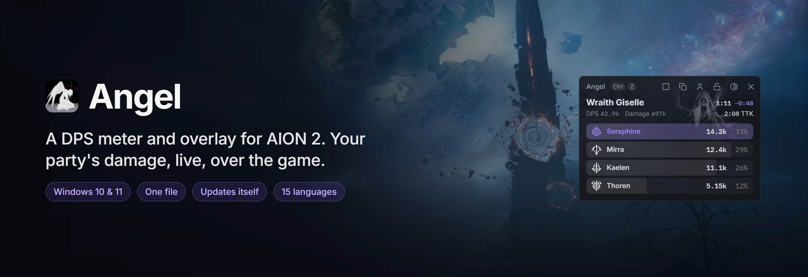
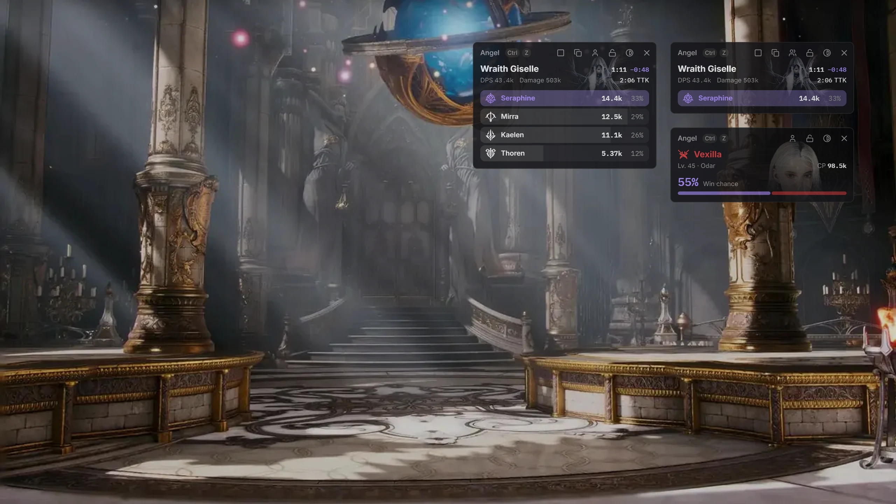
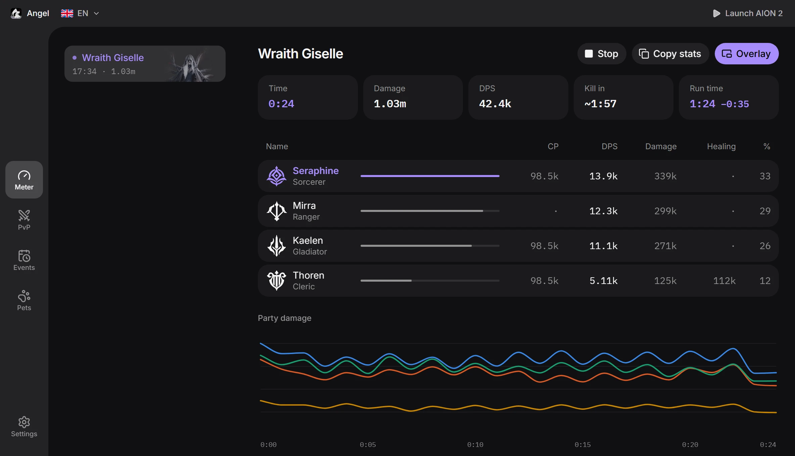
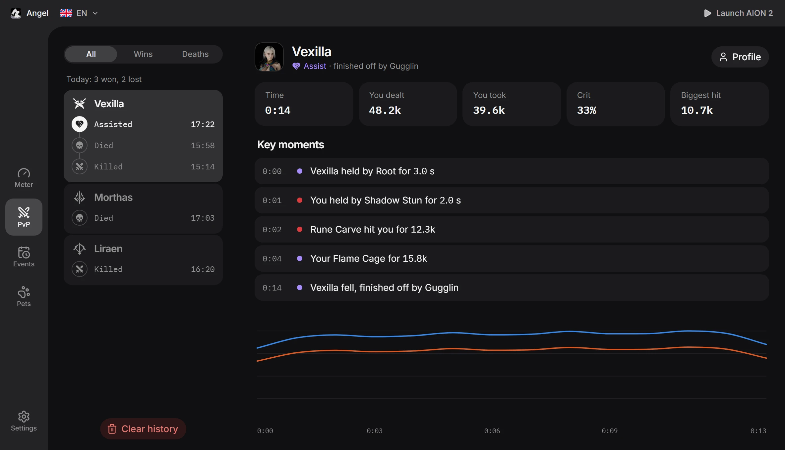

  

  
  
  

<b>English</b> · <a href="#русский">Русский</a>

Angel shows your party's damage in AION 2 as you fight: in its own window, and in a small overlay over the game that never takes its focus. One file, no installer, Windows 10 and 11.

## What it does

- **Meter.** Every player's damage, DPS, healing and share, by the second and by skill. Boss fights are kept, with your best time per dungeon boss.
- **Overlay.** Over the game and out of its way: your party's bars in a fight with your record marked under your own, your pet's souls while you farm, your opponent and your chance in PvP.
- **DPS tests.** Hit a training dummy and the fight is kept as a test; give it a length (1–5 min) and it ends on the dot, against your record on that dummy.
- **PvP.** Each encounter that ends in a death is kept: how it went, exchange by exchange, and the key moments.
- **Events, pets and cubes.** Timers for the events you follow, your pet collection with where each soul drops, and a radar for hidden cubes.
- **Profiles.** A player's gear, skills and combat power from the official site, a click away.
- **15 languages.** English, Russian, German, French, Spanish, Italian, Portuguese, Polish, Dutch, Czech, Swedish, Turkish, Korean, Japanese and Chinese.
- **Something wrong?** Save the last 2 minutes of the game's packets right after, or make a report (log, settings and those 2 minutes in one file) to send. If a game update stops Angel reading damage, it says so.

## Install

1. Download [**Angel.exe**](https://github.com/nokttsu/angel-releases/releases/latest/download/Angel.exe) from the latest release.
2. Run it. Windows asks for administrator rights: Angel reads the game's network traffic.
3. If Npcap is not installed, Angel offers to install it (it is built in). Start Angel before you log in to the game.

If Windows SmartScreen stops it, choose **More info → Run anyway**: the exe is not code-signed with a certificate.

## Updates

Angel checks this page's latest release as it starts and every few hours, and installs a new version only when you say so (Settings → Updates). Every exe here is signed: before it replaces itself, Angel checks the download's SHA-256 and its Ed25519 signature against the key built into it, and refuses anything else. What changed is on the [releases page](https://github.com/nokttsu/angel-releases/releases) and in Angel after an update.

## How it works

Angel only reads the traffic the game server sends to your PC, as a packet capture does. It never reads or changes the game's memory, injects nothing and sends nothing to the game. Profiles come from the official AION 2 site; nothing about you is sent anywhere else.

---

## Русский

Angel показывает урон вашей группы в AION 2 прямо во время боя: в своём окне и в маленьком оверлее поверх игры, который не забирает у неё фокус. Один файл, без установки, Windows 10 и 11.

### Что умеет

- **Метр.** Урон, DPS, лечение и доля каждого игрока, по секундам и по умениям. Бои с боссами сохраняются, с лучшим временем на каждом боссе подземелья.
- **Оверлей.** Поверх игры и не мешает: полоски группы в бою с отметкой вашего рекорда, души пета во время фарма, противник и шанс на победу в PvP.
- **Тесты DPS.** Бейте тренировочную куклу — бой сохранится как тест; задайте длину (1–5 мин), и он закончится секунда в секунду, а рядом будет ваш рекорд на этой кукле.
- **PvP.** Каждый бой, который закончился смертью, сохраняется: как он шёл, размен за разменом, и ключевые моменты.
- **События, петы и кубы.** Таймеры событий, коллекция петов с местами, где падают души, и радар скрытых кубов.
- **Профили.** Снаряжение, умения и боевая сила игрока с официального сайта — в один клик.
- **15 языков**, включая русский.
- **Что-то не так?** Сохраните последние 2 минуты пакетов сразу после или соберите отчёт (журнал, настройки и эти 2 минуты в одном файле), чтобы отправить. Если обновление игры сломает чтение урона, Angel скажет об этом.

### Установка

1. Скачайте [**Angel.exe**](https://github.com/nokttsu/angel-releases/releases/latest/download/Angel.exe) из последнего релиза.
2. Запустите. Windows попросит права администратора: Angel читает сетевой трафик игры.
3. Если Npcap не установлен, Angel предложит его поставить (установщик встроен). Запускайте Angel до входа в игру.

Если Windows SmartScreen остановит запуск, нажмите **Подробнее → Выполнить в любом случае**: exe не подписан сертификатом.

### Обновления

Angel проверяет последний релиз на этой странице при запуске и раз в несколько часов, а новую версию ставит, только когда вы скажете (Настройки → Обновления). Каждый exe здесь подписан: перед заменой Angel сверяет SHA-256 и подпись Ed25519 со встроенным ключом и отказывается от всего остального. Что изменилось — на [странице релизов](https://github.com/nokttsu/angel-releases/releases) и в самом Angel после обновления.

### Как это работает

Angel только читает трафик, который сервер игры присылает на ваш компьютер, как это делает захват пакетов. Он не читает и не меняет память игры, ничего не внедряет и ничего не отправляет в игру. Профили берутся с официального сайта AION 2; о вас никуда ничего не отправляется.
